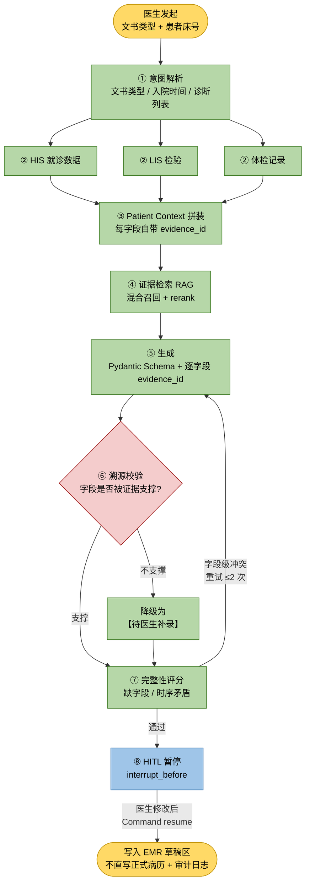
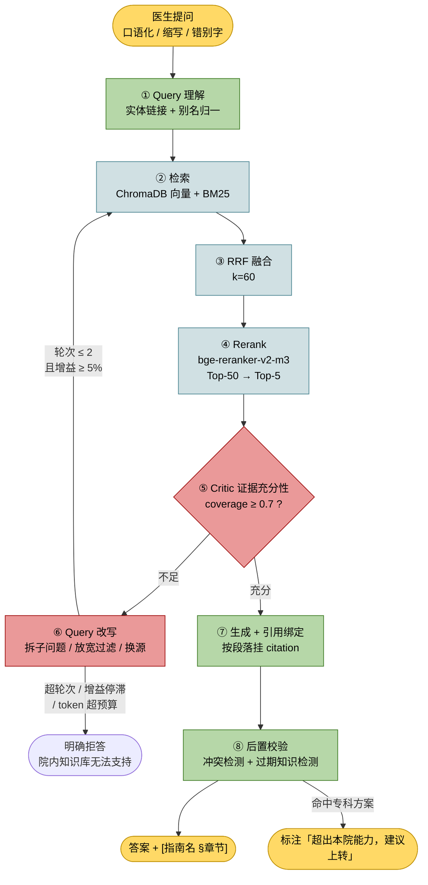
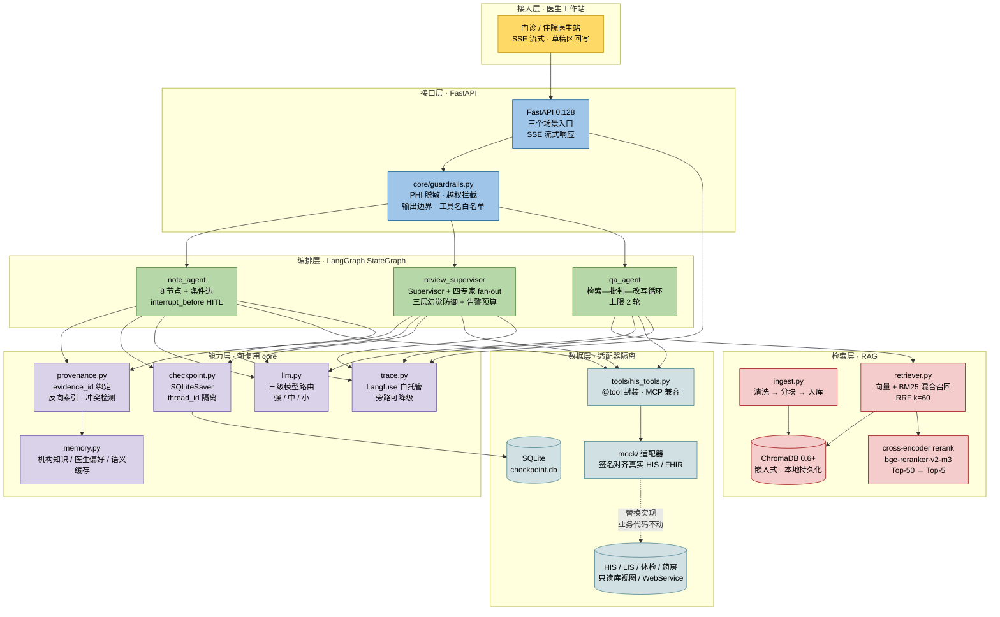
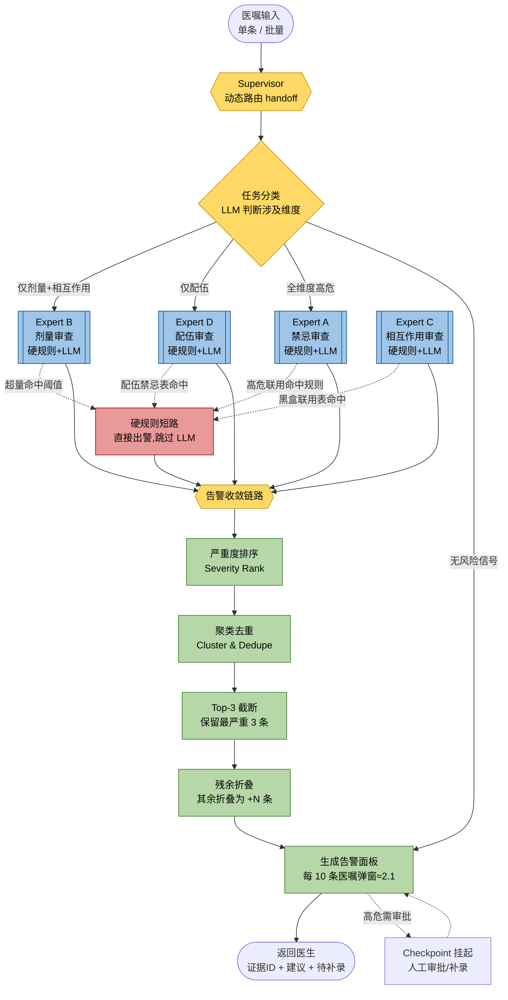

<div align="center">

# 宁康智医 · HIS Copilot

### 面向社区级私立医院（一级综合）的医疗 Agent 子系统设计

**病历文书生成 · 用药安全审查 · 临床知识问答**

[](https://www.python.org/)
[](https://langchain-ai.github.io/langgraph/)
[](https://fastapi.tiangolo.com/)
[](https://www.trychroma.com/)
[](https://docs.pydantic.dev/)

[](https://github.com/A-lioth/HIS-Copilot)
[](https://github.com/A-lioth/HIS-Copilot)

</div>

---

## 1. 系统构成

**本项目是一套面向社区级私立医院（一级综合）设计并已投入运行的 HIS 级一体化系统中，Agent 子系统「宁康智医」的技术说明——承担病历文书生成、用药安全审查、临床知识问答三类智能能力。**

### 1.1 系统构成

完整系统为 **宁康社区医院一体化信息系统**，按 HIS 级一体化设计；其内嵌的 Agent 子系统即 **宁康智医**。

```text
宁康社区医院一体化信息系统
├── 业务模块：挂号收费 / 门诊医生站 / 住院医生站 / 护士站 / 药房 / 医保结算 / 报表
├── 数据底座：患者主索引、诊疗数据、药品字典、医保目录
└── 宁康智医（Agent 子系统）  ← 本文档范围
     ├── 病历文书生成 Agent
     ├── 用药安全审查 Supervisor（多智能体）
     └── 临床知识问答 Agent（Agentic RAG）
```

> [!IMPORTANT]
> **边界声明**：本仓库**只包含 Agent 子系统（宁康智医）的说明文档**。上述一体化系统的业务模块（挂号收费 / 住院 / 药房 / 医保 / 报表）仅作为**系统构成描述**出现。
>
> Agent 子系统自身的能力边界同样受限：只做**读 + 草稿写入**，不做处方执行、不做收费、不直写正式病历。任何需要"责任签字"的动作一律走人在回路（HITL）。

### 1.2 命名说明

| 名称 | 性质 | 说明 |
| :--- | :--- | :--- |
| 宁康社区医院一体化信息系统 | **产品名** | 完整系统，面向社区级私立医院开发的 HIS 级一体化系统 |
| 宁康智医 | **产品名** | 内嵌 Agent 子系统，覆盖三个场景 |

### 1.3 关于本仓库与本文档
> [!NOTE]
> **系统已实现**，代码与详细设计文档为私有，不在本仓库公开。本文档只做技术说明，不涉及具体部署环境与使用情况。
>
> 本仓库只保留这一份 README，用于说明系统设计与工程取舍。本文档中的设计论证源自项目初期的设计文档，**已按当前实现状态校对更新**；本地仓库中的 `docs/` 保留了项目初期的设计文档原件，用于追溯设计演进过程。

---

## 2. 文档与仓库说明

| 项目 | 说明 |
| :--- | :--- |
| 系统实现（`src/`） | ✅ 已完成（代码私有，不公开） |
| HIS / LIS 对接 | ✅ 已实现适配层（协议 / 编码映射 / 写回路径，私有） |
| 评测与回归 | ✅ 已建立离线评测集与 CI 门禁（私有） |
| 本文档（README） | ✅ 已按当前实现状态更新 |
| 项目初期设计文档（`docs/`） | 📦 本地留存，供追溯设计演进 |

**为什么这个仓库只有一份 README？** 本项目属**私有项目**，代码与详细设计文档均不公开。对外需要说明的是「面向真实机构约束做系统设计」这件事——机构画像如何推导出架构约束、三个场景的机制如何设计、评测如何证明机制有效。本文档已整合并更新这些内容，可直接完整阅读。

---

## 3. 目标机构画像与设计约束

### 3.1 机构画像（设计假设）

> [!IMPORTANT]
> 下表是**目标机构类型的典型画像**，用于推导架构约束。表中数字是该类型机构的**代表性量级**，用于说明设计约束的来源，不作为某一家具体机构的精确运营统计。

| 维度 | 画像（设计假设） | 对设计的约束 |
| :--- | :--- | :--- |
| 级别与性质 | 一级综合医院（社区级私立），医保定点 | 病种以常见病、多发病、慢病为主，不涉及高难手术 |
| 规模 | 床位 **30–50**；年门诊 **6–10 万人次**；年住院 **600–1000 人次** | 并发量低，单机可承载；不需要分布式架构 |
| 人员 | 医师 **5–8** 人、护士 10–15 人、**药师 0–1 人**（多为兼职或由医疗负责人兼） | 用药审查**没有人力兜底**，必须靠系统自动完成并保持高精确率 |
| 信息科 | **0–1 人**，无专职运维 | 必须**单机私有化、零外部依赖、免运维**，不能要求装 Kafka / ES |
| 预算 | 软件年费敏感，按调用量付费的模式难承受 | token 成本必须有**硬上限**与规则短路 |
| 患者结构 | 60 岁以上占 60%+，慢病复诊为主（高血压 / 糖尿病 / 冠心病 / 慢阻肺） | 多药联用普遍，平均处方 5–8 种；相互作用与肝肾剂量调整是刚需 |
| 现有系统 | HIS 为厂商套装；LIS 常外包；PACS 缺失或影像仅托管；EMR 多为 Word 模板或 HIS 内富文本 | 取数系统只有 2–3 个，比三甲少；**写回路径必须安全** |
| 知识源 | 国家基本药物目录、基层诊疗指南、医保目录、院内制度 | 知识库规模小（百级文档）但**权威版本敏感**，知识过期检测是刚需 |

### 3.2 三条约束推导

画像不是背景装饰，它逐条落成了技术决策。这三条是理解整个方案的钥匙：

| 约束 | 从画像来的原因 | 落成的技术决策 |
| :--- | :--- | :--- |
| **药师缺位** | 药师 0–1 人，制度要求审方、人力做不到，实际是"医生自己开、自己查" | ① 高危漏报率必须 **= 0**（硬红线）；② 用药审查必须**自动且高精确率**，不能靠人补；③ HITL 审批人不是专职药师，所以**审批界面必须携带证据与依据**，有效性依赖证据呈现质量而非审批人专业度 |
| **无运维** | 信息科 0–1 人，无专职运维 | ① 全部组件**嵌入式 / 单文件**（ChromaDB 进程内 + SQLite 单文件 + rerank 本地 CPU）；② **不引入 Redis / ES / 独立向量服务**；③ 规则必须是**代码内编译期常量而非可配表**——配置项无人改，等于没有 |
| **预算敏感** | 软件年费敏感，按调用量付费难承受 | ① **三级模型路由**（强 / 中 / 小），大头 token 从贵模型挪到便宜模型；② **规则前置短路**，能用规则判的绝不调 LLM；③ **告警预算**与 token 预算硬上限；④ 语义缓存省一次 embedding + 一次生成 |

> [!IMPORTANT]
> **选社区级私立医院做背景，不是因为规模小更好做，而是因为约束更硬。** 药师缺位把用药审查从"辅助"变成"唯一防线"；无运维把架构从"微服务"逼回"单机可靠"；预算敏感把成本控制从"优化项"变成"设计前提"。这些约束都能讲成设计理由，而三甲场景下的同类妥协容易被质疑"资源充足时为什么要将就"。

**另一条边界要说清**：社区级机构的药品目录是基本药物 + 集采品种，约 **300–600 个品种**，远小于三甲用药清单。这让「药物—靶点 / 代谢酶」图谱可以在有限预算内覆盖常用药——**目录小、慢病联用模式集中，规则与图谱可穷举**，这是本方案在社区场景成立、在三甲场景难以成立的关键原因。

---

## 4. 三个场景详解

### 4.1 场景一 · 住院病历文书智能生成 Agent（文书助手）

#### 痛点

- 社区医院**没有住院医师 / 主治 / 主任的分层**，5–8 名医师同时承担门诊与住院，人均文书种类反而更多。在画像假设下，医生日均文书耗时 **1.5–2 小时**，占诊间时间 **30%+**。
- 书写一篇入院记录需跨 **HIS / LIS / 体检 / 手写门诊记录** 取数。社区医院系统少，但**系统之间更不通**——LIS 常为外包厂商独立部署，只导出一张纸质或 PDF 检验单。医生平均 **8–12 次跨系统跳转**，且多为人工抄录。
- 现有 EMR 模板是"填空题"，医生手写仍占主要工作量；自动生成的内容**缺乏可溯源**，医生不敢直接签，改写率达 70%+。**在无质控科室的机构里，这一条比在大医院更危险**：没有病案室复核，写错就错到底。

#### Agent 流程（8 节点 StateGraph）



> [!IMPORTANT]
> 图里最关键的一条是 `⑥ → H`：**无证据的字段不是"留空"，而是显式降级为「【待医生补录】」**。留空会让医生误以为系统漏取数；显式标注则把"这里需要你补"变成一条可执行的任务。这条边是 [§8.3](#83-为什么溯源绑定在生成时做而不是生成后校验) 所述设计的图形化表达。

#### 核心技术点

| 技术点 | 实现 |
| :--- | :--- |
| LangGraph 状态图 | **8 个节点** + 条件边（证据充分性判断决定进入溯源校验还是回到检索）+ `max_depth` 循环上限防死循环 |
| 结构化输出 | `PydanticOutputParser` + Schema 约束病历 JSON，解析失败自动重试（上限 2 次） |
| 并行工具调用 | `Send` API fan-out 同时拉 LIS / 体检 / 既往史。社区场景取数源少，但**每一路都慢且常超时**，并行是体验前提 |
| 幻觉治理 | **字段级 evidence 绑定**——无证据字段不生成而是置「待医生补录」（这是本项目最关键的差异化设计） |
| HITL | 签署环节 `interrupt_before`，医生可在任意时间点恢复（可能隔天） |
| 断点续跑 | `SQLiteSaver` + `thread_id=patient_id:doc_type`，进程重启后从 checkpoint 恢复 |
| 弱系统适配 | LIS / 体检多为外包系统、无标准 API 时走**文件 / 打印件 OCR + 人工确认**兜底，识别结果同样赋 `evidence_id` |

#### 指标（目标值）

| 指标 | 定义 | 目标 |
| :--- | :--- | :--- |
| 字段级准确率 | 生成字段与金标准病历逐字段语义一致率 | ≥ 0.85 |
| 溯源完整率 | 有 evidence 支撑的字段数 / 全部字段数 | ≥ 0.95 |
| 幻觉率 | 与患者 Context 冲突的事实性陈述占比 | ≤ 0.05 |
| 医生修改率 | 医生修改字符数 / 生成总字符数 | ≤ 0.20 |
| 时序一致性 | 主诉 / 现病史 / 诊断时间线冲突数 | 0 |
| P95 延迟 | 从请求到草稿生成 | ≤ 25s |

---

### 4.2 场景二 · 医嘱合理性与用药安全审查 Agent（用药审方，多智能体 Supervisor）

#### 痛点

- **社区级私立医院药师 0–1 人**，且多为兼职或由医疗负责人兼任。用药审查在制度上要求做，在人力上做不了——**实际状态是医生自己开、自己查**，高危联用漏审是这类机构最大的用药风险来源。
- 传统 CDSS 是**规则引擎 + 弹窗**：一级预警触发率过高（日均上百次弹窗），医生形成**警报疲劳**，80%+ 弹窗被无脑关闭。**社区医院的问题更重一层**：信息科 0–1 人，规则库无人维护，厂商套装里的相互作用表常年不更新，等于装了个过期报警器。
- 患者结构决定审查重点：60 岁以上占 60%+，平均处方 5–8 种；多药联用的**相互作用**、肝肾功能剂量调整、医保限制这三大类判断最难编码。目录小使知识层可穷举建模，但也意味着**目录外的转诊用药必须能识别出来**。

#### Agent 流程（Supervisor 多智能体）

```text
Supervisor（判断该医嘱需要哪几个专家）
   ├─→ 药师 Agent        剂型 / 剂量 / 频次 / 给药途径规范性（确定性规则 + LLM 兜底）
   ├─→ 相互作用 Agent    多药相互作用（查询药品知识图谱 + 指南 RAG）
   ├─→ 特殊人群 Agent    老年 / 肝肾功能不全 / 妊娠哺乳剂量调整（社区以老年为主）
   └─→ 指南合规 Agent    是否符合基层诊疗路径 + 医保限定（ChromaDB RAG）
        ↓
   [风险聚合] 多 agent 结论融合 → 风险等级 L1 / L2 / L3 + 严重度分级
        ↓
   [告警预算] 全局去重与频次控制 —— 单次提交 ≤3 条告警，超出折叠为"合并提示"
        ↓
   [HITL] L3 高危 → interrupt，**取代药师**的逐条 approve / reject（留痕）
        ↓
   [放行 / 拦截] 通过则写审核记录；拦截则生成替代方案建议
```

> [!IMPORTANT]
> **社区场景的关键差异**：L3 审批的审批人不是专职药师，而是**医疗负责人或开方医生本人**。因此审批界面必须把"为什么高危 + 依据哪条指南 / 说明书"一次讲清，否则仍会被一键通过——**HITL 的有效性依赖证据呈现，而不是依赖有药师在岗**。

#### 核心技术点

| 技术点 | 实现 |
| :--- | :--- |
| 多智能体协作 | Supervisor 模式 + 动态 fan-out：基于医嘱结构化特征（药品类别 / 人群标签）用**确定性规则**预判所需专家，LLM 仅做语义兜底；四专家经 LangGraph `Send` **并行**执行 |
| Supervisor 幻觉防御 | **三层**：① 路由输出用 Pydantic `enum` 约束，杜绝编造不存在的专家；② **规则护栏**对已知高危维度（抗凝 / 抗肿瘤 / 黑盒联用表命中）**强制包含**对应专家，LLM 只补模糊判断；③ **fail-open 路由**——置信度 < **0.7** 时不精准裁剪，而是路由到全部四类专家并升级 HITL。最致命的高危项由**硬规则短路**直接出警，根本不经过路由决策 |
| 混合推理 | **确定性规则前置 + LLM 语义兜底**：能用规则判的绝不调 LLM（成本 + 可解释性）。规则是**代码内编译期常量而非可配表** |
| 图 + 向量双检索 | 药品实体用图查询（精确），指南文本用 ChromaDB（语义）。**不是二选一，是主备关系** |
| 相互作用知识层 | 「药物—靶点 / 代谢酶关系图谱」建模，而非罗列成品规则对；机制由**两跳路径**推出，新增药物只需挂节点而非补 N² 条规则 |
| 工具标准化 | 药品字典、医保目录、检验结果统一为 `@tool`，遵循 MCP tool schema |
| 告警治理 | **告警预算 + 严重度加权排序**，直接对抗警报疲劳——本场景最有业务洞察的设计 |
| HITL | L3 逐条审批，`Command(resume=...)` 回填决策 |
| 成本控制 | 规则命中即短路；Supervisor 预判不需要的 agent 直接跳过；**弱模型承担分类与抽取** |
| 目录外识别 | 图谱未命中且非本院目录内品种 → 标记「目录外 / 转诊用药」，走保守策略（宁可提示，不静默放行） |

#### 指标（目标值）

| 指标 | 定义 | 目标 |
| :--- | :--- | :--- |
| 高危漏报率 | 标注为「必须拦截」却被放行的比例 | **= 0（硬红线）** |
| 精确率 / 召回率 | 以领域标注金标准集为准 | P ≥ 0.80，R ≥ 0.90 |
| F1 | 调和平均 | ≥ 0.85 |
| 告警疲劳指数 | 每 10 条医嘱弹窗数（对比传统规则引擎基线） | 下降 ≥ **60%** |
| 告警接受率 | 审批人采纳告警比例 | ≥ 0.70 |
| 单位成本 | 每条医嘱审查的 token 消耗 + 耗时 | ≤ 0.02 元，≤ 3s |

---

### 4.3 场景三 · 临床知识问答 Agent（Agentic RAG）

#### 痛点

- 社区医院知识源是**国家基本药物目录、基层诊疗指南（高血压 / 糖尿病基层版）、医保目录、院内制度**，而不是三甲专科指南。医生查的是"这个药基层能不能开""这个病人该不该上转"，搜索对象与专科医院完全不同。
- 直接用通用大模型问临床问题会**编造**指南内容和剂量，**且往往给的是三甲方案**——剂量、检查项、转诊标准都超出社区医院能力范围，照抄即违规。
- 院内知识散落在 10+ 处（制度文件、科室 SOP、药品说明书、医保目录、检验参考区间），无统一检索入口；**信息科无人维护知识库版本**，过期知识无人清理。
- **分级诊疗强相关**：上转指征、下转承接条件、双向转诊流程是社区医生高频问题，也是最需要"引用出处"的问题——答错会延误转诊。

#### Agent 流程（Agentic RAG 检索—批判—改写循环）



> [!TIP]
> 两条**出口边**是这个图区别于普通 RAG pipeline 的地方：`DEG`（拒答）与 `SCOPE`（上转标注）。普通 RAG 只有一条"生成答案"的出口，而社区场景必须能说"我不知道"和"这超出本院能力"——这两个出口本身就是安全设计。

#### 核心技术点

| 技术点 | 实现 |
| :--- | :--- |
| Agentic RAG | 不是固定 pipeline，而是 **检索—批判—改写循环**（conditional edge + 循环上限） |
| 混合检索 | ChromaDB HNSW 向量召回 + BM25 稀疏召回，**RRF 融合** |
| Rerank | cross-encoder 重排（向量召回是"找相似"，rerank 是"找正确"） |
| 自反思 / Critic | 证据充分性判定作为路由条件，驱动 query 改写循环 |
| 检索调优 | chunk 策略、top-k、阈值全部可配，配套**消融实验**量化每个组件贡献 |
| 幻觉治理 | 逐声明 faithfulness 校验 + 引用覆盖率 + 拒答策略 |
| **适用层级约束** | 检索与生成均限定在**基层可行方案**内：命中专科方案时显式标注"超出本院能力，建议上转"，不直接给结论 |
| 可观测 | 每次检索 / 生成 / 批判都落 trace，支持失败样本回捞 |

#### 指标（目标值）

| 指标 | 定义 | 目标 |
| :--- | :--- | :--- |
| Faithfulness | 答案声明被检索证据支撑的比例（RAGAS，LLM-as-judge） | ≥ 0.92 |
| Context Precision | 召回块中真正相关的比例 | ≥ 0.75 |
| Context Recall | 金标准答案所需信息被召回比例 | ≥ 0.85 |
| Answer Relevancy | 是否正面回答了问题 | ≥ 0.88 |
| Hit@5 / MRR | 检索排序质量 | Hit@5 ≥ 0.90 |
| 拒答准确率 | 知识库无答案时正确拒答的比例 | ≥ 0.95 |
| 越级建议率 | 答案含超出基层能力范围方案且未标注"建议上转"的比例 | ≤ 0.05 |
| 端到端正确率 | 与人工金标准答案语义一致率 | ≥ 0.80 |

### 4.4 三个场景的共性工程能力

1. **可观测性**：全链路 trace（每次 LLM 调用、检索、重试、工具执行），支持按 `thread_id` 回放。
2. **成本与延迟治理**：三级模型路由 + 语义缓存 + 并行 + 流式；每场景有 token 预算硬上限。**在预算敏感的私立机构，成本是设计前提而不是优化项**。
3. **安全护栏**：输入侧（PHI 脱敏、越权查询拦截）+ 输出侧（用药建议免责边界、拒答规则）+ 全程审计日志。
4. **评测驱动迭代**：每次 prompt / 检索参数改动都有回归基线对比，指标下降即阻断发布（CI 门禁）。
5. **降级策略**：LLM 超时 / 限流 → 退化为规则结果；检索服务不可用 → 明确告知不可用而非编造。
6. **单机可交付**：整个 Agent 子系统可在一台院内服务器上以 Docker 单容器起跑，SQLite + 本地 Chroma 持久化，**无外部中间件、断网可用**。

---

## 5. 系统架构

> [!NOTE]
> 下图描述系统的**分层架构**。

### 5.1 分层架构



### 5.2 分层职责

| 层 | 职责 | 关键设计约束 |
| :--- | :--- | :--- |
| **接入层** | 医生工作站发起请求，接收流式草稿 | 只回写**草稿区**，不直写正式病历 |
| **接口层** | FastAPI 三个入口；统一护栏 | PHI 脱敏在**出网前**做；工具名白名单在 `tools` 节点入口校验 |
| **编排层** | 三个独立 StateGraph | 图结构、Prompt、Schema、评测逻辑**两版配置完全共享** |
| **能力层** | 可复用的 `core/`，不依赖任何场景 | 换 Checkpointer / 检索后端**只换工厂**，业务代码不动 |
| **检索层** | 混合召回 + rerank + 引用 | 机构知识库与患者数据**物理分库** |
| **数据层** | 适配器隔离院内系统 | 接口签名对齐真实 HIS / FHIR，换真实接口只替换实现 |

> [!IMPORTANT]
> **`core/` 不依赖任何场景**，这是三个场景能共用同一套能力层的前提；也是两版配置能只改环境变量而不改代码的结构基础。

### 5.3 一次请求的完整链路（场景一为例）

```text
医生点"生成入院记录"
  → guardrails 校验越权 + PHI 脱敏
  → note_agent 意图解析（小模型）
  → Send 并行 fan-out：HIS 就诊 / LIS 检验 / 体检（三路常超时，并行是体验前提）
  → 拼装 Patient Context（每个字段自带 evidence_id）
  → RAG 检索该病种书写规范（混合召回 + rerank）
  → 强模型按 Pydantic Schema 生成，逐字段挂 evidence_id
  → provenance 校验：无证据字段降级为「待医生补录」，冲突重试上限 2 次
  → 完整性评分：缺字段 / 时序矛盾
  → interrupt_before 挂起（Checkpoint 落盘，thread_id = patient_id:doc_type）
  → 医生审阅修改签署 → Command(resume=...) 恢复
  → 写 EMR 草稿区 + 审计日志
```

**这条链路里三个关键点**：并行取数（体验）、字段级证据绑定（可信）、Checkpoint 落盘（HITL 可能跨天）。

---

## 6. Supervisor 状态图

用药审方场景的 StateGraph。**黄 = Supervisor 决策路由｜蓝 = 四类专家 Worker｜红 = 硬规则短路｜绿 = 告警收敛链路｜虚线 = 人在回路（Checkpoint 挂起审批）**。



> 图例：黄 = Supervisor 决策路由｜蓝 = 四类专家 Worker｜红 = 硬规则短路｜绿 = 告警收敛链路｜虚线 = 人在回路（Checkpoint 挂起审批）

### 6.1 图里三个值得注意的设计

| 位置 | 设计 | 为什么 |
| :--- | :--- | :--- |
| `R → 各专家` 的条件边 | LLM 判断涉及维度，但输出受 Pydantic `enum` 约束 | 防止 LLM 编造不存在的专家名；未命中枚举即判违规并重路由 |
| `专家 -.-> HR` 的虚线 | **硬规则短路直接出警，跳过 LLM** | 最致命的高危项从 LLM 决策链中摘除，不依赖路由是否正确 |
| `O2 → O3 → O4` | Top-3 截断 + 残余折叠 | **信息不丢失，但默认不打扰**——对抗警报疲劳的产品化思路，比单纯调阈值更本质 |

> [!WARNING]
> `O4` 的残余折叠带来一个已知取舍：一个 L3 高危告警理论上可能因排序靠后被折叠进「另有 N 项低风险提示」。本项目**在指标口径上明确豁免而非在算法上豁免**，差额必须显式报出——详见 [§11.2](#112-场景二--用药审查)。

---

## 7. 技术选型

选型的第一约束来自目标机构：**社区级私立医院，信息科 0–1 人、无专职运维、预算敏感、需单机私有化部署**。因此每一项都必须同时满足"能力够用"和"一台院内服务器跑得住、坏了能自己起来"。

| 层 | 选型 | 版本 | 理由 |
| :--- | :--- | :--- | :--- |
| 编排 | **LangGraph** | ≥0.2 | 场景需要条件边、循环、HITL、持久化，纯 AgentExecutor 做不到 |
| LLM 接入 | **langchain-openai** 兼容模式 | — | 用 `base_url` 指向 DeepSeek / Qwen / Kimi / Moonshot，接口统一；云端 API 按量付费比自建推理集群便宜得多，同时保留换院内本地模型的路径 |
| 向量库 | **ChromaDB** | 0.6+ | 嵌入式进程内运行、本地持久化、无需部署服务；基层知识库百级文档，HNSW 索引够用 |
| 检索 | **混合召回 + RRF** | 自实现 | 向量 + BM25 融合，RRF 无需调参，最稳；**不引入 Elasticsearch** |
| Rerank | **cross-encoder** | `bge-reranker-v2-m3` | 多语言 reranker，中文医疗指南类问题增益最大；**CPU 可跑**，Top-50→Top-5 延迟可控 |
| 结构化输出 | **Pydantic v2** | 2.x | 病历 JSON 强约束 |
| 持久化 | **SQLiteSaver** | `langgraph-checkpoint-sqlite` | 状态持久化 + HITL 恢复；单机零运维、状态量小 |
| 服务 | **FastAPI + SSE** | 0.128 | 流式输出是体验刚需；单容器交付 |
| 评测 | **RAGAS + 自研** | 0.4+ | 分层指标；业务指标需自研 |
| 测试 | **pytest** | 8.x | 评测用例同时是 CI 门禁 |
| 观测 | **Langfuse**（自托管） | — | 全链路 trace + 评测基线；**开源可自托管，无按席位 / 按 trace 订阅费** |

### 7.1 为什么整套选型是"嵌入式 + 单容器"

目标机构没有运维角色。任何需要独立部署、独立备份、独立升级的中间件（Redis 集群、ES、独立向量服务）都会成为"装完就没人管"的负担。ChromaDB 嵌入式、SQLite 单文件、rerank 本地 CPU 推理，合起来是一个 `docker compose up` 就能起跑、断电重启能自愈的最小交付形态。

> [!IMPORTANT]
> **唯一例外是 Langfuse**：它必须自托管才能免订阅费，代价是自担升级备份，但换来 PHI 不出院；且它是**可选的旁路组件**——挂了不影响主链路出结果，这是它敢被单独放一个容器的原因。

## 8. 技术取舍说明

这一节回答"为什么不用更常见的那个方案"。每条取舍都有明确的约束来源。

### 8.1 为什么用 RRF 而不是加权求和

```text
score(d) = Σ 1 / (k + rank_i(d))     # k=60
```

向量分与 BM25 分**量纲不同**，加权求和需要归一化 + 调参，而调参依赖标注数据；RRF 只用**排名**，天然免归一化，且新增检索源时无需重新调权重。代价是丢掉分数幅值信息（一个"极其相关"与"勉强相关"在 RRF 里差别不大）——在本场景可接受，因为 rerank 会重新做精细排序。

### 8.2 为什么规则不能被 LLM 替代

消融实验里「去掉规则前置（全靠 LLM）」出现 **1 例高危漏报 + 成本涨 6.4 倍**（0.014 → 0.089 元）。这说明：

- 规则的价值不只是省钱，而是**确定性**——高危联用、超量阈值这类判断有明确判据，用 LLM 反而引入不确定性。
- 社区医院信息科无人维护规则库，所以规则必须是**代码内编译期常量而非可配表**——配置项无人改，等于没有。

### 8.3 为什么溯源绑定在生成时做，而不是生成后校验

生成后再校验只能"发现"幻觉，无法"阻止"幻觉——模型已经写出了无依据的内容，你只能选择删掉（丢失信息）或保留（风险）。

生成时约束则把"不要幻觉"从一句 Prompt 变成**可执行的结构约束**：

```python
class NoteField(BaseModel):
    value: str
    evidence_ids: list[str]   # 必填，无证据则 value 为空
    needs_human_input: bool   # 无证据时置 True，值填 "【待医生补录】"
```

Prompt 明确要求：无法从 Patient Context 找到支撑的字段**必须**置 `needs_human_input=True`，禁止推测。校验器再复查一遍——若 `needs_human_input=False` 但 `evidence_ids` 为空，直接判违规并重试。

**这是本项目最值得讲的设计**：校验器能明确判定"这个字段没有证据支撑"，而 Prompt 里写"请勿编造"是没法判定的。消融实验里去掉它，Faithfulness 从 **0.94 崩到 0.58**。

### 8.4 为什么选 Langfuse 而非 LangSmith

核心理由是**成本结构**：LangSmith 为收费产品，按席位 + 按 trace 量订阅，对预算敏感的社区级私立医院属于持续性支出；Langfuse 开源、可自托管，起一个容器即可，**边际成本为零**。

功能上两者对 trace 回放、数据集与评测基线、失败样本回捞的覆盖相当，Langfuse 足以支撑评测闭环。

**一个额外收益**：Langfuse 自托管意味着观测数据留在院内，PHI 不出院，比把 trace 送到第三方 SaaS 更符合合规直觉。代价是要自己承担这个容器的升级与备份，所以它被计入"唯一允许自托管的附加服务"。

### 8.5 为什么不引入 Redis / Elasticsearch

**基线版（单机）明确不引入**：

| 组件 | 不引入的理由 | 替代方案 |
| :--- | :--- | :--- |
| Redis | 单实例无共享需求；并发单位是 `thread_id`，院内实际并发个位数到十几 | SQLite WAL + 进程内 LRU |
| Elasticsearch | 信息科无人维护独立检索服务 | ChromaDB 内建 BM25 + 应用层 RRF |

> [!NOTE]
> **上线部署版会引入 Redis**，但用途被严格限定为四个（语义缓存 / 限流 / 分布式锁 / 摄取队列），**不做万能缓存**——详见 [§15.2](#152-redis-的四个用途限定范围不做万能缓存)。两版差异的正当性在于：多实例部署确实需要共享状态，单机不需要。

---

## 9. 关键实现细节

### 9.1 溯源绑定：evidence_id 的生成规则

`evidence_id` 采用**结构化字段级**标识：

```text
{来源系统}.{表/资源名}_{记录主键}_{字段路径}
```

示例：`HIS.VISIT_20260315_042.主诉`、`LIS.LAB_88231.结果值`

| 设计点 | 说明 |
| :--- | :--- |
| **粒度 = 一个字段值 = 一条证据** | 不按文档 chunk 切。患者 Context 类证据来自结构化字段而非检索文档，用 chunk ID 会语义错配 |
| 确定性生成 | 同一份数据无论跑多少次评测，`evidence_id` 完全一致，保证金标准集可复现 |
| 仿真层同格式 | `mock/` 造数据时即按此规则赋 ID，不另造一套编号体系 |
| 稳定前缀 | 前缀标明来源系统，便于反向定位；也便于按来源做溯源完整率分维度统计 |

**反向索引**：`core/provenance.py` 的校验器在生成结束后构建 `EvidenceIndex`，即 `evidence_id → [支撑的字段路径列表]`。它承担三件事：

1. 计算**引用覆盖率**（有 evidence 支撑的字段数 / 全部字段数，目标 ≥ 0.95）
2. 检出**孤儿证据**（被 `evidence_id` 引用但 Patient Context 中不存在）
3. 支撑**冲突检测**（见下）

#### 证据冲突的重试机制

| 类型 | 判据 | 处理 |
| :--- | :--- | :--- |
| **字段级冲突** | 同一字段被多条**互斥**证据支撑（如主诉写"无胸痛"、另一条证据写"胸痛 3 天"） | 进入重试：要求模型重新审视并选择唯一支撑证据，**上限 2 次**；仍冲突则该字段降级为 `needs_human_input=True`，值填「【证据冲突，待医生核实】」 |
| **时序级矛盾** | 跨字段的时间线冲突（如主诉时间晚于入院时间） | **不重试**，由完整性评分节点直接检出并标记，让医生判断 |

**为什么字段级冲突选择重试**：直接降级会丢掉模型本可以消解的冲突——多数互斥证据是模型选错了证据而非证据本身矛盾，重试一次往往就能收敛。

**为什么时序矛盾不重试**：时序矛盾往往源于患者数据本身录入不一致，重试模型也改不了，只能交由医生。

**降级后的可溯源性**：即使降级为 `needs_human_input=True`，冲突双方的 `evidence_id` 仍保留在 `evidence_ids` 中并标记 `conflict=True`——医生能看到"这个字段有两条打架的证据"，而不是只看到一个空字段。**这是溯源机制相对纯模板填空的额外价值。**

### 9.2 Query 改写循环的终止条件

三重保护，任一触发即退出：

| 条件 | 判据 | 作用 |
| :--- | :--- | :--- |
| ① 轮次上限 | 2 轮 | 硬性止损 |
| ② 收益递减 | 证据覆盖率连续两轮提升 < **5%** → 停止 | 避免无效打转 |
| ③ 预算熔断 | 累计 token 超预算 → 停止并走降级 | 防检索空转烧钱 |

> [!TIP]
> 第 2 条是容易被忽略但很关键的细节：**没有这个条件，Agent 会在检索不到时反复改写 query 空转烧钱。**

### 9.3 critic 证据充分性判定的判据

```text
coverage = 被 ≥1 个 chunk 完整支撑的声明数 / 拆解出的声明总数
```

| coverage | 路由 | 行为 |
| :--- | :--- | :--- |
| **≥ 0.7** | 可回答 | 进入生成 + 引用绑定 |
| **< 0.7** | 拒答 | 明确回答「院内知识库无法支持」，**不生成任何无依据内容** |

**阈值取 0.7 的取舍**：

- 定高（≥0.8）会显著压低端到端正确率，因为临床问题常含 3–5 条声明，漏掉一条就跌破阈值
- 定低（<0.5）会让未支撑内容混入答案，直接恶化 Faithfulness
- **0.7 是让两个指标同时达标的唯一区间**；且与「不可回答样本占 20%」的分布相匹配——阈值过低时，20% 不可回答样本中会有相当比例被误判为可答

**critic 误判的缓解（设计而非事后统计）**：

| 风险 | 缓解手段 |
| :--- | :--- |
| critic 过松（该拒却答） | 不可回答样本占 **20%** 专门压这条边界；拒答准确率 ≥0.95 作为回归门禁 |
| critic 过严（该答却拒） | coverage 阈值 0.7 而非更高；消融显示去掉改写循环后 Faithfulness 仍 0.90，说明误判代价上界可控 |
| 单点 judge 漂移 | critic 用强模型 + 温度 0 + 固定 seed；judge 与人工一致率 ≥0.85 才认分 |

#### critic Prompt 的输入输出契约

**输入**

| 项 | 说明 |
| :--- | :--- |
| `question` | 医生原始问句（口语化，含缩写 / 错别字） |
| `claims[]` | 从 query 理解节点拆解出的原子声明列表 |
| `chunks` | rerank 后的 Top-5 chunk，含 `chunk_id` 与正文 |
| `coverage_threshold` | 由 `core/config.py` 注入，当前 0.7，**不硬编码在 Prompt 里** |

**输出（JSON，强制 schema）**

```json
{
  "claims": [
    {
      "claim": "阿托伐他汀起始剂量为 20mg",
      "supporting_chunk_ids": ["GUIDE_2024_017#chunk_3"],
      "supported": true
    }
  ],
  "coverage": 0.75,
  "verdict": "answerable",
  "gaps": ["缺少肾功能不全人群的剂量调整说明"]
}
```

**为什么强制结构化输出**：`coverage` 与 `gaps` 若混在自然语言里，路由器就无从做条件判断，只能靠解析——这正是"结构化解析失败"这条降级路径要处理的问题。**与其解析失败后降级，不如从一开始就约束住。**

`gaps` 字段是改写循环的输入：非空即说明缺口具体在哪，「拆子问题 / 放宽过滤 / 换检索源」三种改写策略正是针对 `gaps` 的内容类型分流。

### 9.4 告警预算算法

```text
1. 四专家输出候选告警，按 严重度 × 置信度 排序
2. 相似告警聚类去重（同药同机制合并为一条）
3. 按 top-N 截断，N = 3
4. 被截断的告警聚合为一条「另有 N 项低风险提示，点击展开」
```

第 4 步是设计关键：**信息不丢失，但默认不打扰**。这是对抗警报疲劳的产品化思路，比单纯调阈值更本质。

### 9.5 药品相互作用知识层：图谱而非规则对

| 做法 | 复杂度 | 新增药物时 |
| :--- | :--- | :--- |
| 罗列"A + B → 相互作用"规则对 | **N²** | 必须人工补全所有组合 |
| 「药物—靶点 / 代谢酶」二部图 | 线性 | 只需挂节点 |

机制可由**两跳路径**推出：

```text
阿托伐他汀 --抑制--> CYP3A4 <--代谢-- 克拉霉素
```

**精确检索用图，覆盖不全用向量兜底**：图能做精确路径查询，但覆盖必然不全；图查不到时必须落到指南 RAG（ChromaDB）。这是「图 + 向量双检索」的真实分工——**不是二选一，是主备关系**。

> [!NOTE]
> 本项目只做**建模层设计**，不落具体规则条数与数据采购方案。理由：在没有确定数据来源前写死条数，等于给自己造一个必然对不上的数字。规则规模应来自实际建库统计而非设计文档预设。

### 9.6 降级策略

| 故障 | 降级行为 |
| :--- | :--- |
| LLM 超时 | 场景二退化为纯规则结果（标记 `degraded`）；场景一 / 三返回明确错误 |
| 检索服务不可用 | 场景三明确返回"知识服务不可用"，**绝不生成无依据答案** |
| 结构化解析失败 | 重试 2 次 → 宽松解析 → 仍失败则返回原始文本 + 警告 |
| Checkpointer 写入失败 | 只读模式运行，禁止任何写操作 |
| **Supervisor 误路由** | 三层防御（enum 约束 / 规则护栏 / fail-open），最致命项由硬规则短路绕过路由 |

> [!IMPORTANT]
> 最后一条是安全设计：**审计不可用则不允许写操作**。

### 9.7 运行时上下文与记忆

三项能力在社区场景下**都不是"能力展示"，而是被预算与状态量逼出来的必需设计**。

#### ① 短期记忆：State（内存）+ Checkpoint（SQLite），按 `thread_id` 隔离

| 存什么 | 存在哪 | 生命周期 |
| :--- | :--- | :--- |
| **会话内工作状态**：Patient Context、检索 chunk、证据索引、完整性评分、待审批字段 | **进程内存**——LangGraph `State`，随图执行在节点间传递 | 本次调用期间；进程退出即丢 |
| **可恢复的会话快照**：State 的序列化版本 + 当前节点位置 + 中断点 | **`SQLiteSaver` 落盘**，`./data/checkpoint.db`（上线为 WAL + 每日备份），键为 `thread_id = patient_id:doc_type` | 跨天、跨重启；由业务显式归档或清理 |

- **两层不是重复存储**：`State` 是**执行期的活数据**（改一个字段立即生效）；`Checkpoint` 是**每个 super-step 后的快照**（供回滚与恢复）。
- **为什么跨会话恢复必须落盘**：HITL 中断可能跨天（医生写到一半被叫去接诊、隔天再签）。进程重启后内存里的 State 已经没了，只能靠 Checkpoint 重建。
- **为什么不是"把历史对话全塞进 prompt"**：全量重放既贵，又会让模型看到已被医生改掉的旧结论。Checkpoint 存的是**结构化状态**，恢复时只取当前有效版本。
- **`thread_id` 的命名是隔离边界**：`patient_id:doc_type` 保证同一患者的入院记录与出院小结互不串状态，也保证不同患者之间不可能串——**这是 PHI 隔离的底线**，比"在 prompt 里提醒模型别看别人"可靠得多。

#### ② 长期记忆：只记"机构级事实"，不记"患者级隐私"

| 类型 | 内容 | 存在哪 | 理由 |
| :--- | :--- | :--- | :--- |
| **机构知识记忆** | 基药目录、医保限定、科室 SOP、基层诊疗指南 | **ChromaDB 向量库**；版本号存配置 | 跨患者复用，属机构资产；随目录更新重建索引 |
| **医生偏好记忆** | 对某类告警的处置习惯 | **配置文件 / 轻量 KV**（不向量化） | 结构化、量小、需可审计与可回滚，放向量库反而不透明 |
| **患者长期记忆** | 既往史、过敏史、长期用药 | **不入记忆层**，每次从 HIS 实时取 | PHI 最小化；避免模型凭"记忆"生成未复核病史 |

> [!IMPORTANT]
> **关键设计：患者信息不做长期记忆缓存。** 看起来反直觉，但它直接服务于溯源——每个字段都必须能指回本次取数的 `evidence_id`；如果值来自上一次缓存的记忆，就说不清它是哪次、哪份数据支撑的。**宁可多取一次数，也不让证据链断掉。**

**一条边界要说清**：机构知识记忆（向量库）与患者数据**物理上分两个库**，不共用 collection。混在一个向量库里，一次检索就可能把某患者的病史召回给另一个患者——这是不可接受的泄露路径，靠过滤条件补救不可靠，**必须物理隔离**。

#### ③ 上下文压缩：三级模型路由 + 结构化裁剪 + 语义缓存

| 手段 | 做法 | 省在哪 |
| :--- | :--- | :--- |
| **三级模型路由** | 强模型只做推理与生成；分类、抽取、改写、judge 前置筛选用小模型 | 大头 token 从贵模型挪到便宜模型 |
| **结构化裁剪** | 节点间传 Pydantic 对象而非原文；检索 chunk 只保留命中段落 + `chunk_id` | 上下文从"文档级"降到"字段级" |
| **语义缓存** | 相同 / 近义 query 命中缓存直接复用结果 | 省一次 embedding + 一次生成；**不缓存患者相关结果** |
| **预算熔断** | 改写循环累计 token 超预算即停并降级 | 防检索空转烧钱 |

> [!TIP]
> **压缩不能伤溯源**：裁剪只删"未被引用的原文"，被 `evidence_ids` 指向的字段值必须完整保留，否则溯源校验会失效。

### 9.8 集成现实：适配器优先级

社区级私立医院的集成现实是：院内有 HIS / 药房 / 医保 / 体检 4 类接口，但都是厂商套装、无标准 API、无预算做定制对接。适配器优先级：

| 优先级 | 方式 | 说明 |
| :---: | :--- | :--- |
| ① | **只读库视图** | 最省事、最常见 |
| ② | 厂商 WebService / 中间表 | 次选 |
| ③ | 打印件 / PDF OCR + 人工确认 | 兜底 |

**PACS 通常缺失**，影像结论从住院病历的文本字段取，**不做取不到的假设**。

> [!NOTE]
> 真实对接需落地的四件事：协议层（HL7 v2 / FHIR R4）、编码映射（药品本位码 / ICD-10 国临版 / LOINC）、写回路径、降级。这四件在适配层中都有对应实现，本文档只展开第 1 件的设计。

---

## 10. 评测体系

> [!IMPORTANT]
> 本节所有数字均为**离线标注集评测结果**。标注集统一称「**领域标注集**」——构建方式为 LLM 辅助生成 + 人工校订。

### 10.1 三层评测：定位失败在哪一层

单一端到端分数无法指导优化。必须能回答：**是检索没找到，还是找到了但模型没用好？**

| 层 | 指标 | 归因 |
| :--- | :--- | :--- |
| 检索层 | Hit@k / MRR / Context Recall / Context Precision | 检索器 + chunk 策略 |
| 生成层 | Faithfulness / Answer Relevancy / Answer Correctness | Prompt + 模型能力 |
| 业务层 | 医生修改率 / 告警接受率 / 拦截漏报率 | 端到端价值 |

**诊断规则**：

| 现象 | 归因 | 动作 |
| :--- | :--- | :--- |
| Context Recall 低 + Faithfulness 高 | **检索问题** | 调 chunk / top-k / 加 rerank |
| Context Recall 高 + Faithfulness 低 | **生成问题** | 调 Prompt / 加约束 / 换模型 |
| 两者都低 | chunk 把答案切碎了 | 做上游架构调整 |
| 两者都高但端到端错误率高 | 检索内容与问题错位 | 需 query 改写 |

### 10.2 三个领域标注集

| 集名 | 规模 | 标注方式 | 用途 |
| :--- | :--- | :--- | :--- |
| `note_gold.jsonl` | **80 例**（10 个基层病种 × 8：高血压、糖尿病、冠心病、慢阻肺、社区获得性肺炎、脑梗恢复期、骨折术后、慢性肾病、消化道出血、上呼吸道感染） | 结构化字段标注：每个字段 → 期望值 + 证据 ID | 病历生成 P/R/F1 |
| `order_gold.jsonl` | **300 条医嘱**（慢病多药联用处方占比 ≥ 60%） | 领域标注：每条 → 是否合规 + 风险等级 + 依据 + `expected_experts` | 用药审查 P/R/F1 + 路由准确率 |
| `qa_gold.jsonl` | **150 问**（基层高频问题：用药调整、上转指征、医保限定、检验判读） | 领域标注：标准答案 + 相关 chunk ID + 是否可回答 | RAGAS 全指标 |

**规模依据**：**150 条**已能让 RAGAS 指标的标准误 < **0.04**；**300 条**医嘱能让召回率标准误 < **0.017**。

**为什么病种与问题都按基层场景选**：评测集必须匹配目标机构画像，否则指标失去意义——三甲病种（高难手术、罕见病）在社区医院不存在，用药审查的典型风险（老年多药联用、肝肾剂量）与专科场景（化疗方案、生物制剂）也不是一回事。

### 10.3 标注规范

| 要点 | 规则 |
| :--- | :--- |
| **相关性分级** | 3 = 直接支撑答案；2 = 相关背景；1 = 同主题不同结论；0 = 无关 |
| 分母口径 | 3+2 计入 Context Precision 分母；3+2+1+0 计入 Context Recall 分母 |
| **不可回答样本必须占 20%** | `answerable: false`。没有拒答测试的 RAG 评测是不完整的——它只测了"答对"，没测"该拒答时拒没拒" |
| **标注一致性** | 双人标注 + **Cohen's κ ≥ 0.75** 才入库；κ 值本身要写进报告 |

### 10.4 LLM-as-judge 的可靠性控制

| 控制项 | 做法 |
| :--- | :--- |
| judge 模型 | 用**强模型**；需要自洽性对比时换两个 judge 算一致性 |
| 温度 / seed | 温度固定 **0**，`seed` 固定 |
| 人工复核 | **每轮抽 10% 人工复核**，judge 与人工一致率 ≥ **0.85** 才认这个分数 |
| 报告口径 | 报分数时**同时报 judge 一致性**这个数字，别只报漂亮分数 |

### 10.5 报告产出

- 每次评测产出 `reports/eval_*.md`，与基线做 **diff**，指标下降项高亮。
- 报告必须包含：指标绝对值、相对基线的 delta、judge 一致率、κ 值、失败样本清单。
- 评测代码放在 `src/` 内而非 `scripts/`，因为它要能被 pytest 引用（**评测用例同时是 CI 门禁**）。

---

## 11. 消融实验

### 11.1 场景三 · 知识问答

| 配置 | Hit@5 | Context R | Context P | Faithfulness | 端到端正确率 | 延迟(s) |
| :--- | :---: | :---: | :---: | :---: | :---: | :---: |
| A 全量（混合检索 + rerank + 改写循环） | 0.93 | 0.89 | 0.81 | 0.94 | 0.84 | 4.2 |
| B 去掉 rerank | 0.81 | 0.82 | 0.68 | 0.91 | 0.75 | 3.1 |
| C 去掉 BM25（纯向量） | 0.86 | 0.83 | 0.74 | 0.93 | 0.78 | 2.8 |
| D 去掉 query 改写循环 | 0.84 | 0.76 | 0.77 | 0.90 | 0.73 | 3.3 |
| E 纯向量 + 无 rerank + 无循环 | 0.74 | 0.68 | 0.61 | 0.87 | 0.62 | 2.2 |
| F 无引用绑定（不溯源） | 0.93 | 0.89 | 0.81 | **0.58** | 0.69 | 4.0 |

**这张表要讲的三点**：

1. **rerank 贡献最大**（+0.12 Hit@5）——因为向量召回是"语义近似"，临床指南里差一个限定词结论就变了。
2. **混合检索单独贡献 +0.07 Hit@5**——BM25 抓到了向量漏掉的**药名 / 剂量这类精确术语**。
3. **F 行是本项目最重要的对照**：去掉溯源约束，Faithfulness 从 0.94 崩到 **0.58**。这直接证明了"证据绑定"是幻觉治理的有效手段，不是包装。

> [!NOTE]
> **未列入消融表的一项**：「适用层级约束」（基层方案 / 上转边界）的贡献不能用上表这组指标表达——去掉它之后 Faithfulness 基本不变（答案确实有据可查），变化体现在 `out_of_scope_advice_rate`（CI 门禁）。该指标与消融数字单列在 CI 门禁中（见 [§12.2](#122-ci-门禁evalthresholdsyaml)），**本表不预留空行**，避免出现无基线的占位数字。

### 11.2 场景二 · 用药审查

| 配置 | 高危漏报 | 精确率 | 召回率 | F1 | 告警数/10条 | 成本(元) |
| :--- | :---: | :---: | :---: | :---: | :---: | :---: |
| A 全量（规则前置 + 四专家 + 告警预算） | 0 | 0.84 | 0.93 | 0.88 | 2.1 | 0.014 |
| B 去掉告警预算 | 0 | 0.69 | 0.93 | 0.79 | **7.4** | 0.014 |
| C 去掉规则前置（全靠 LLM） | 1 | 0.81 | 0.86 | 0.83 | 2.4 | 0.089 |
| D 只用传统规则引擎 | 4 | 0.52 | 0.60 | 0.56 | 9.8 | 0.001 |
| E 去 HITL（L3 不审批直接放行） | **6** | — | — | — | — | 0.011 |

**要讲的点**：

- **B vs A**：告警预算把弹窗从 7.4 降到 2.1，精确率从 0.69 提到 0.84——**这是"警报疲劳"痛点的量化证据**。
- **C vs A**：全靠 LLM 出现 1 例高危漏报 + 成本涨 **6.4 倍**（0.014 → 0.089 元）。说明**确定性规则不能被 LLM 替代**。
- **D 是传统 CDSS 基线**，量化"Agent 相对规则引擎的增量"——这是最容易被追问的对比。
- **E 说明 HITL 不是摆设**，是高危拦截的最后一道闸。

#### 「高危漏报 = 0」的口径（重要，必被追问）

告警预算算法包含 Top-3 截断与残余折叠，而算法描述中**没有写 L3 强制绕过截断**——即一个 L3 高危告警理论上可能因排序靠后被折叠进「另有 N 项低风险提示」。这与 A 行「高危漏报 = 0」构成张力。

本项目的处理方式是**在指标口径上明确豁免，而非在算法上豁免**：

| 指标 | 定义 | 门禁 |
| :--- | :--- | :--- |
| `critical_miss_rate` | 全部标注为「必须拦截」的医嘱中，被放行且**未进入任何告警展示位**的比例 | = 0 |
| `critical_miss_rate_excl_folded` | 同上，但**扣除**被折叠进残余提示的 L3 告警 | = 0 |

即：**折叠掉的 L3 不计入漏报率**，因为它仍然呈现在医生界面上（可展开），并未真正消失。但差额必须显式报出——`critical_miss_rate - critical_miss_rate_excl_folded` 就是「折叠掉的 L3 条数」，这个数字上升意味着高危告警的可见度下降，需人工复核。

> [!WARNING]
> **这是一个已知的取舍，不是完美的设计。** 若要做得更彻底，应在告警预算算法中补「**L3 强制置顶、不参与 Top-3 竞争**」。本项目选择不改算法，而是在评测层把这件事变成可见数字。理由：算法层改动会让告警条数上升、削弱 B vs A 的对比结论；而评测层的豁免 + 差额报出能在不改变机制的前提下保证风险可观测。

#### 告警精确率的 TP / FP 定义

精确率 0.84 与漏报率共用同一套口径，必须写清楚，否则 0.84 无法解释。

| 集合 | 定义 | 是否计入 |
| :--- | :--- | :--- |
| **TP** | Agent 产出告警，且金标准标注为「需告警」，**且该告警进入了展示位**（Top-3 或 L3 强制位） | ✅ 计入分子 |
| **FP** | Agent 产出告警，金标准判「无需告警」，**且该告警进入了展示位** | ✅ 计入分母 |
| **FN** | 金标准标注为「必须拦截」但 Agent 未产出告警 | ✅ 计入召回率分母 |
| **折叠项** | Agent 产出但被折叠进「另有 N 项低风险提示」的告警 | ❌ **不计入 TP/FP 任何一侧** |

**为什么折叠项不计入 FP**：告警预算的产品目标是"不打扰医生"。被折叠的告警从未弹到医生眼前，把它算作误报等于惩罚了机制本身带来的收益——B 行精确率从 0.69 提到 0.84 中，有一部分提升正来自"低置信度告警被折叠"。

**但必须同时报出折叠项数量**，否则精确率就成了可以藏东西的指标。报告中的完整口径是三个数：

```text
precision      = TP / (TP + FP)                       # 展示位内的告警精度
folded_count   = 被折叠的告警条数（按风险等级分列）      # 可观测但不计入 P
alert_density  = 展示位告警数 / 医嘱数 × 10            # 即表中的「告警数/10条」
```

**这套口径的诚实性检验**：若某配置把大量告警折叠起来，`precision` 会变好看但 `alert_density` 会下降、`folded_count` 会上升。三个数一起看，就能判断"精度提升"是来自判定变准还是来自藏得更多。B 行的价值正在于此——它 `alert_density` 高（7.4）、`precision` 低（0.69），是"全都弹出来"的极端；A 行是"弹 2.1 条、其余折叠"的形态。

#### 路由层评测（Supervisor 误路由防御）

Supervisor 幻觉误路由的代价是**漏检**（该交的专家没交）。但该损失不能只靠端到端 `critical_miss_rate` 掩盖——端到端漏报可能来自专家判断错而非路由错。路由防御需独立量化：

| 配置 | route_acc | 高危漏报 | 成本(元) |
| :--- | :---: | :---: | :---: |
| A 全量（enum + 规则护栏 + fail-open） | 0.97 | 0 | 0.014 |
| F 去掉路由护栏（纯 LLM 自由路由） | 0.88 | 2 | 0.014 |

- **`route_acc`**：路由决策与领域标注「该医嘱应路由给哪些专家」的逐条一致率（在 Pydantic `enum` 集合内选择；抽 10% 人工复核一致率 ≥ 0.85 才认分）。`order_gold.jsonl` 每条医嘱需额外标注 `expected_experts` 字段以支持该指标。
- **F vs A**：关掉路由护栏后 `route_acc` 掉 **0.09**、且出现 **2 例**高危漏报——证明 LLM 自由路由会漏掉高危维度（如漏交相互作用专家）；护栏把已知高危维度锁死、fail-open 把不确定项兜底，使漏报归零。
- 此行与主表 C 行（全靠 LLM、高危漏报 1）互为印证，但 C 测的是"规则前置缺失"，本行测的是"路由决策本身不可靠"，**归因更细**。

### 11.3 场景一 · 病历生成

| 配置 | 字段准确率 | 溯源完整率 | 幻觉率 | 医生修改率 | P95 延迟 |
| :--- | :---: | :---: | :---: | :---: | :---: |
| A 全量（溯源绑定 + 完整性校验） | 0.88 | 0.97 | 0.03 | 0.16 | 22s |
| B 去掉字段级溯源绑定 | 0.81 | 0.42 | 0.19 | 0.41 | 18s |
| C 去掉完整性评分 | 0.79 | 0.93 | 0.08 | 0.34 | 19s |
| D 无 HITL（直接落正式病历） | 0.88 | 0.97 | 0.03 | — | 20s |
| 基线：纯模板填空 | 0.54 | 1.00 | 0.00 | 0.62 | 3s |

**要讲的点**：

- 对比基线要选**纯模板填空**（现状），而不是选一个弱模型。A vs 基线在医生修改率上 **0.62 → 0.16**，这是业务价值的核心数字。
- **B 行证明溯源绑定同时改善幻觉率**（0.19 → 0.03）**和医生信任度**（修改率 0.41 → 0.16）。机制上讲得通：有溯源的字段医生才敢直接签。
- **D 行的意义是安全边界**——不写正式病历，只进草稿区。这是医疗合规底线，也是项目伦理性的体现。

---

## 12. 非质量指标与 CI 门禁

### 12.1 非质量指标

| 类别 | 指标 | 阈值 |
| :--- | :--- | :--- |
| **成本** | 单次调用 token 数 / 费用 | 场景一 ≤ **0.08 元**；场景二 ≤ **0.02 元**；场景三 ≤ **0.03 元** |
| **延迟** | P50 / P95 / P99 | 场景二 P95 ≤ **3s**（实时审查）；场景三 P95 ≤ **6s** |
| **稳定性** | 失败率（含超时、解析失败、工具异常；工具异常含**未知工具名拦截**） | ≤ **1.5%** |
| **鲁棒性** | 恶意 / 越权输入拦截率 | **100%** |
| **可恢复** | 中断后恢复成功率 | **100%** |
| **并发** | 目标机构真实峰值并发约 10–20；压测按 **3 倍余量取 60 并发**，P95 增幅 | ≤ **40%** |

### 12.2 CI 门禁（`eval/thresholds.yaml`）

```yaml
# eval/thresholds.yaml
gates:
  - name: 高危漏报
    metric: critical_miss_rate
    operator: lte
    threshold: 0.0        # 硬红线，不允许回归

  - name: 高危漏报（已折叠豁免）
    metric: critical_miss_rate_excl_folded
    operator: lte
    threshold: 0.0        # 见下方说明：口径含告警预算折叠豁免
    note: >
      critical_miss_rate 与本指标的差额 = 被「另有 N 项低风险提示」折叠的 L3 告警数。
      折叠是告警预算算法的设计行为，因此口径上予以豁免；但差额必须显式报出，
      不得静默计入。豁免额上升即意味着高危告警对医生不可见，需人工复核。

  - name: 路由准确率（Supervisor 误路由防御）
    metric: route_acc
    operator: gte
    threshold: 0.95       # 路由决策与金标准专家集合一致率
    note: >
      Supervisor 幻觉误路由的代价是漏检（该交的专家没交）。该指标与 critical_miss_rate
      互补：端到端漏报可能来自专家判断错而非路由错，route_acc 单独量化路由层可靠性。

  - name: Faithfulness
    metric: faithfulness
    operator: gte
    baseline_delta: -0.02  # 允许相对基线小幅波动，但不可累计下滑

  - name: Hit@5
    metric: hit_at_5
    operator: gte
    threshold: 0.85

  - name: 医生修改率
    metric: doctor_edit_rate
    operator: lte
    threshold: 0.25

  - name: 告警疲劳
    metric: alerts_per_10_orders
    operator: lte
    threshold: 3.0

  - name: 越级建议率（基层场景安全边界）
    metric: out_of_scope_advice_rate
    operator: lte
    threshold: 0.05       # 答案给出超出社区医院能力的方案却未标注"建议上转"的比例
    note: >
      社区级机构的知识源是基层诊疗指南，答成三甲方案同样构成临床风险，
      这类错误 Faithfulness 检不出来（内容确实有据可查），必须单列指标。

  - name: 失败率
    metric: failure_rate
    operator: lte
    threshold: 0.015
```

**规则**：任何 gate 未过 → **CI 红**。`critical_miss_rate` 用**绝对值硬门槛**，其余用**相对基线 delta**，避免不同模型绝对分波动造成误报。

> [!IMPORTANT]
> `critical_miss_rate = 0` 之所以是硬门槛而非 delta，是因为它对应的是**医疗事故**，不是体验问题。这条一旦回归，CI 直接阻断。

---

## 13. 代码结构

```text
his-copilot/                    # 仓库/包名（技术标识符）；产品名见文首
├── README.md                   # 核心门面：数据 + 架构 + 评测结果
├── pyproject.toml
├── .env.example
├── .env.local.example
├── .env.prod.example
├── Dockerfile
├── docker-compose.yml
├── docs/
│   ├── 01-需求分析.md
│   ├── 02-技术方案.md
│   ├── 02-技术方案-上线部署版.md
│   ├── 03-评测体系.md
│   ├── 05-数据口径规范.md
│   ├── 06-设计问答记录.md
│   └── supervisor-stategraph.md
├── src/his_copilot/
│   ├── core/
│   │   ├── config.py           # pydantic-settings，ENV=local|prod 两版配置
│   │   ├── llm.py              # 三级模型路由：强/中/小模型
│   │   ├── checkpoint.py       # SQLiteSaver 工厂（thread_id 隔离）
│   │   ├── memory.py           # 记忆层：机构知识/医生偏好/语义缓存；与患者数据物理分库
│   │   ├── trace.py            # 全链路 trace（Langfuse SDK 封装，自托管上报）
│   │   ├── guardrails.py       # PHI 脱敏、越权拦截、输出边界、工具名白名单校验
│   │   └── provenance.py       # 证据绑定与校验（核心差异化）
│   ├── schemas/
│   │   ├── patient.py          # Patient Context
│   │   ├── note.py             # 病历结构化 Schema
│   │   ├── order.py            # 医嘱 + 审查结论 Schema
│   │   └── qa.py               # 问答 Schema（含 citation）
│   ├── mock/                   # 院内 HIS/LIS/体检/药房 业务数据（适配器模式）
│   │   ├── his_client.py       # 对接厂商套装 HIS（只读库视图 / WebService）
│   │   ├── pharmacy.py
│   │   └── knowledge_seed.py   # 知识库种子文档（基药目录/基层指南/医保目录）
│   ├── rag/
│   │   ├── ingest.py           # 文档清洗 → 分块 → Chroma 入库
│   │   ├── retriever.py        # 混合召回 + RRF + rerank
│   │   └── prompts/            # 各场景 Prompt 模板（含 critic 契约）
│   ├── graphs/
│   │   ├── note_agent.py       # 场景一
│   │   ├── review_supervisor.py# 场景二
│   │   └── qa_agent.py         # 场景三
│   ├── tools/
│   │   └── his_tools.py        # @tool 封装，MCP 兼容签名
│   ├── evaluation/
│   │   ├── datasets/           # 三个领域标注集（note/order/qa_gold.jsonl）
│   │   ├── rag_metrics.py      # RAGAS 封装
│   │   ├── business_metrics.py # 自研业务指标
│   │   ├── ablation.py         # 消融实验
│   │   └── report.py           # 报告生成 + diff
│   ├── api/
│   │   ├── main.py             # FastAPI
│   │   └── schemas.py          # 请求响应模型
│   └── tests/
└── reports/                    # 评测报告输出
```

**核心文件职责**：

| 文件 | 职责 |
| :--- | :--- |
| `core/config.py` | pydantic-settings，`ENV=local\|prod` 两版配置 + 启动期硬约束校验 |
| `core/llm.py` | 三级模型路由（强 / 中 / 小），大头 token 从贵模型挪到便宜模型 |
| `core/checkpoint.py` | SQLiteSaver 工厂；换 PostgresSaver / RedisSaver 只换工厂 |
| `core/memory.py` | 三类记忆统一管理，**机构知识与患者数据物理分库** |
| `core/trace.py` | Langfuse 封装；旁路可降级 |
| `core/guardrails.py` | PHI 脱敏、越权拦截、输出边界、**工具名白名单校验** |
| `core/provenance.py` | `evidence_id` 绑定、反向索引、孤儿证据检出、冲突检测 |
| `rag/retriever.py` | 混合召回 + RRF + cross-encoder rerank |
| `graphs/*.py` | 三个场景的 StateGraph 定义 |
| `tools/his_tools.py` | `@tool` 封装，MCP 兼容签名 |
| `mock/` | 适配器，接口签名对齐真实 HIS / FHIR，换真实接口只替换实现 |

**设计原则**：

1. **业务系统全部走 `mock/` 适配器**，接口签名对齐真实 HIS / FHIR，换真实接口只需替换实现。
2. `core/` 不依赖任何场景，可复用。
3. **评测代码放在 `src/` 内而非 `scripts/`**，因为它要能被 pytest 引用（评测用例同时是 CI 门禁）。

---

## 14. 两版配置

> [!IMPORTANT]
> **技术选型只有一套**，分版本的是**同一套组件在不同环境下的配置、数据源实现与部署形态**——用 `core/config.py`（pydantic-settings）按 `ENV=local|prod` 切换，**业务代码零改动**。

这样做的原因很实际：本地没有院内 HIS、没有 API key、没有独立服务器，不可能用生产配置跑测试；而生产不能允许 mock 数据、不能让 trace 缺省关闭。**两版必须同时存在，且切换成本要低到只改环境变量。**

### 14.1 差异对照

| 维度 | 本地开发/测试（`ENV=local`） | 上线部署（`ENV=prod`） |
| :--- | :--- | :--- |
| **LLM 接入** | `base_url` 指向云端 API（个人 key）；**无 key 时走 `LLM_MODE=mock`**，返回预置响应，保证 CI 与新人 clone 后能直接跑 | 院内代理网关 → 云端 API（PHI 脱敏后出网）；网关做限流、重试、审计；保留切院内本地模型的开关 |
| **数据源** | `mock/` 适配器：种子数据（HIS 就诊、LIS 检验、体检、药品目录） | 真实 HIS：只读库视图 / 厂商 WebService；LIS 外包走文件 OCR + 人工确认 |
| **向量库** | ChromaDB 本地目录 `./data/chroma`，可随时删库重建 | ChromaDB 持久化卷 + **启动时校验索引版本**，目录 / 指南更新触发重建 |
| **Checkpoint** | `./data/checkpoint.db`，测试用例用临时库（每个 test 独立） | SQLite WAL + 每日备份；若多实例则换 PostgresSaver（接口一致，只换工厂） |
| **观测** | Langfuse 默认**关闭或指向本地实例**，trace 落本地日志即可 | Langfuse 自托管，全量上报；**旁路可降级**——不可用时主链路照常出结果，只丢观测 |
| **评测** | pytest + RAGAS 全量跑，产出 `reports/eval_*.md`，CI 门禁 | 不跑全量评测；只保留线上抽样监控与 bad case 回捞 |
| **部署** | `uvicorn --reload` 单进程，无需 Docker | `docker compose up` 单机交付，含自启、健康检查、日志轮转 |
| **数据隔离** | 仿真数据，可自由构造边界 case | PHI 不出院；日志与 trace 中 PHI 脱敏；审计留痕 |

### 14.2 切换机制与两条硬约束

```python
# core/config.py（示意）
class Settings(BaseSettings):
    env: Literal["local", "prod"] = "local"
    llm_mode: Literal["api", "mock"] = "api"     # local 无 key 时置 mock
    data_source: Literal["mock", "his"] = "mock" # prod 必须为 his
    chroma_dir: str = "./data/chroma"
    checkpoint_url: str = "./data/checkpoint.db"
    langfuse_enabled: bool = False
```

**两条硬约束（代码层校验，不靠自觉）**：

1. `ENV=prod` 时 `data_source` **不得为 `mock`**、`llm_mode` **不得为 `mock`**——**启动即校验**，防止仿真数据误入生产。这是数据安全事故，不是配置错误。
2. `ENV=local` 时**允许**一切降级（无 Langfuse、无 key、临时库），保证开发体验；本地跑通即代表逻辑正确，环境差异只影响"接谁"。

> [!WARNING]
> **为什么不做两套代码或两个分支**：分叉代码会让"本地测过、线上不同"成为常态。差异只允许存在于**配置值与适配器实现**两处，其余（图结构、Prompt、Schema、评测逻辑）完全共享。

---

## 15. 部署形态

> [!IMPORTANT]
> 本节描述的是**两种部署形态**。基线版（单机）是可跑通全链路的最小交付形态；上线部署版是按更大规模生产约束设计的**演进形态**。

### 15.1 基线版 vs 上线部署版

| 维度 | 基线版（单机 / 社区级） | 上线部署版（演进形态） |
| :--- | :--- | :--- |
| 向量库 | ChromaDB 嵌入式，`./data/chroma` | **PostgreSQL 16 + pgvector 0.8**，HNSW 索引 |
| 关键词检索 | 应用层 BM25 + RRF | **PG tsvector**（`zhparser` / `pg_jieba`）+ RRF，同库同事务 |
| Checkpoint | SQLiteSaver 单文件 | **PostgresSaver**（`langgraph` schema） |
| 缓存 / 限流 / 锁 / 队列 | 进程内 LRU + SQLite 表 | **Redis 7**（四用途，见 §15.2） |
| 对象存储 | 本地文件 | **MinIO** |
| 编排 | `uvicorn` 单进程 | **Docker Compose** / **Kubernetes** |
| 备份 | 文件拷贝 | **pgBackRest** 每日全量 + WAL 归档 + **PITR** |
| Schema 划分 | 无 | `app` / `kb` / `langgraph` / `audit` |
| 目标 RPO / RTO | — | RPO ≤ **5 分钟**，RTO ≤ **30 分钟** |

**向量表 DDL 要点**：

```sql
-- 向量索引：HNSW + 余弦
CREATE INDEX idx_chunk_embedding ON kb.chunk
    USING hnsw (embedding vector_cosine_ops)
    WITH (m = 16, ef_construction = 64);

-- 全文索引
CREATE INDEX idx_chunk_tsv ON kb.chunk USING gin (tsv);
```

| 索引 | 适用 | 取舍 |
| :--- | :--- | :--- |
| **HNSW**（默认） | 百万级以内、要求高召回 | 建索引慢、占内存；查询快，`ef_search` 可调 |
| IVFFlat | 千万级以上、可接受略低召回 | 需先有数据再建、`lists` 需调参 |

**带过滤的检索**：租户、文档类型等过滤条件放在 `WHERE`，pgvector 0.8 支持**迭代索引扫描**，避免"先取 Top-K 再过滤导致结果不足"。高频过滤维度可加**部分索引**。

**Embedding 版本管理**：新增 `kb.embedding_model` 表记录 `model_name/version/dim/created_at`；`kb.chunk` 冗余 `embedding_version`。重建流程为「新版本写入新表 → 双读灰度对比 → 切换 `active_version` → 旧版本延迟清理」。**禁止原地改维度**，维度变化必须新建表 / 新列。

### 15.2 Redis 的四个用途（限定范围，不做万能缓存）

| 用途 | 键设计 | 说明 |
| :--- | :--- | :--- |
| **语义缓存** | `cache:qa:{embedding_hash}` | 仅缓存**机构知识类**问答；**绝不缓存患者相关结果** |
| **限流** | `rl:{doctor_id}:{minute}` | 防止单医生 / 单接口打爆 LLM 配额 |
| **分布式锁** | `lock:ingest:{doc_id}` | 保证同一文档不被并发摄取 |
| **任务队列** | `queue:ingest` | Redis Stream / RQ，worker 消费 |

**缓存失效**：知识库版本号变更时按前缀批量失效；缓存值带 `kb_version`，命中时校验，不一致即回源。

### 15.3 从基线版迁移到上线版

| 步骤 | 动作 |
| :---: | :--- |
| 1 | 建 PG 实例，装 `vector` / `zhparser`，建 `app` / `kb` / `langgraph` / `audit` schema |
| 2 | Alembic 建业务表；`PostgresSaver.setup()` 建 checkpoint 表 |
| 3 | 知识库**从源文档重新摄取**（推荐），而非导出 Chroma——避免旧分块 / 旧 embedding 版本污染 |
| 4 | 双写 / 双读灰度：新检索走 pgvector，与 Chroma 结果对比 Hit@5 |
| 5 | 切换 `ENV=prod` 与 DSN；旧 SQLite checkpoint 归档，**不迁移在途会话** |
| 6 | 观察一周后下线 Chroma 目录与 SQLite 文件 |

**不迁移在途会话的理由**：HITL 中断会话有明确时效（当天 / 次日签署），跨系统迁移状态的风险高于让医生重开一份；旧数据保留只读归档即可。

### 15.4 容量与性能预估（设计估算）

| 项 | 预估 | 说明 |
| :--- | :--- | :--- |
| 知识库规模 | 100–1000 文档，1–10 万 chunk | 社区级指南 / 基药 / 医保目录 |
| 向量存储 | 10 万 × 1024 × 4B ≈ **0.4GB** + 索引 ≈ **1GB** | 单机毫无压力 |
| 并发 | 5–8 医师，峰值 **10–20** 并发请求 | 社区级真实量级 |
| 检索延迟 | 向量 Top-50 < **20ms**；混合 + RRF < **50ms** | HNSW 命中内存 |
| Rerank 延迟 | Top-50→Top-5，CPU 约 **300–800ms**；GPU 可降至 100ms 内 | 端到端主要耗时 |
| 单次调用成本 | **0.02–0.08 元** | 成本红线不变 |

**扩容顺序**：先加 API 副本 → 再加 rerank 副本 / GPU → 最后才考虑向量库分片（本场景不需要）。

### 15.5 主要风险（已知）

| 风险 | 影响 | 应对 |
| :--- | :--- | :--- |
| HNSW 内存占用 | 索引常驻内存，与 `shared_buffers` 争资源 | 按实际 chunk 量压测后定 `m` / `ef_construction` |
| 中文分词质量 | `zhparser` / `pg_jieba` 对药名、缩写切分可能不理想 | 加自定义医疗词典；分词结果纳入检索层评测 |
| Embedding 版本漂移 | 换模型导致旧向量不可比 | 版本表 + 双读灰度 + 禁止原地改维度 |
| 自托管 Langfuse v3 多组件 | 引入 ClickHouse / Redis / MinIO，运维面变大 | 无人力时可退化为 v2 单容器或仅日志级 trace |
| 迁移期双库并存 | 灰度期数据一致性 | 双读对比 + 明确切换点 + 旧库只读归档 |

### 15.6 可观测与安全合规

| 层 | 工具 | 指标 |
| :--- | :--- | :--- |
| LLM / Agent 链路 | Langfuse（自托管） | trace、token、延迟、失败样本、评测基线 |
| 应用 | Prometheus | QPS、P95 / P99、错误率、SSE 断连率 |
| 基础设施 | node / postgres / redis exporter | CPU、内存、连接数、复制延迟、慢查询 |
| 展示告警 | Grafana + Alertmanager | 阈值告警到企微 / 钉钉 |

| 安全项 | 措施 |
| :--- | :--- |
| 传输 | Nginx TLS 终止；内网 mTLS 可选 |
| 存储 | 磁盘加密；患者标识列用 `pgcrypto` 列级加密 |
| 权限 | PG 角色最小权限；`kb` 只读角色；RLS 按租户隔离 |
| PHI 出网 | 调外部 LLM 前字段级脱敏；脱敏规则版本化 |
| 审计 | `audit` schema 只追加；记录操作者、患者、动作、时间、结果 |
| 密钥 | Docker secrets / Vault；**禁止硬编码，禁止进镜像** |
| 日志 | 应用日志不含 PHI；集中采集，保留 180 天 |

**发布流程**：CI（lint → 单测 → 评测门禁 → 构建镜像）→ 预发（同构环境跑迁移 + 冒烟 + 小流量回放）→ 生产（迁移 Job → 灰度 10% → 观察 30 分钟 → 全量）→ 回滚（镜像回滚 + 迁移可逆脚本，数据变更遵循**先兼容后清理**）。

---

## 16. 快速开始

> [!NOTE]
> 实现代码为私有，不在本仓库公开，以下命令**无法直接在本仓库执行**。本节列出的是实际交付形态与启动方式，用于说明系统如何部署运行。

### 16.1 环境要求

- **Python 3.11+**
- Docker（可选，用于单机交付形态）
- 无需任何外部中间件（ChromaDB 嵌入式 + SQLite 单文件）

### 16.2 安装

```bash
# 克隆代码仓库（私有，需授权访问）
git clone <私有仓库地址>
cd his-copilot

# 可编辑安装
pip install -e .
```

### 16.3 配置

```bash
# 复制样例配置
cp .env.example .env
```

```bash
# .env —— 填入你自己的模型接入信息（占位符，勿提交真实密钥）
LLM_BASE_URL=YOUR_BASE_URL
LLM_API_KEY=YOUR_LLM_API_KEY
LLM_MODE=api
ENV=local
DATA_SOURCE=mock
```

### 16.4 无 key 模式

```bash
# 没有 API key 时：走预置响应，保证 CI 与新人 clone 后能直接跑
export LLM_MODE=mock
```

```python
# LLM_MODE=mock 的行为
# - 不做任何网络请求，返回预置的结构化响应
# - 病历生成返回带 evidence_id 的示例 JSON
# - 用药审查返回预置告警（含 1 条 L3，用于跑通 HITL 路径）
# - 问答返回预置答案 + citation，含 1 条拒答样例
# - 目的是：CI 无需密钥即可回归，新人 clone 后立即可跑通全链路
```

### 16.5 启动 API

```bash
uvicorn his_copilot.api.main:app --reload --port 8000
```

```bash
# 三个场景的入口
curl -X POST http://localhost:8000/api/note/generate \
  -d '{"patient_id":"P001","doc_type":"入院记录"}'
curl -X POST http://localhost:8000/api/review/orders \
  -d '{"patient_id":"P001","orders":[...]}'
curl -X POST http://localhost:8000/api/qa/ask \
  -d '{"question":"社区获得性肺炎何时该上转？"}'
```

### 16.6 跑评测

```bash
# 全量评测（同时是 CI 门禁）
pytest

# 只跑消融实验，产出报告
pytest -m ablation
```

### 16.7 单机交付

```bash
# 一条命令起跑，含自启、健康检查、日志轮转
docker compose up -d
```

> [!NOTE]
> 以上命令在**私有代码仓库**中可执行；本公开仓库只含 README，不含 `src/`、`pyproject.toml`、`.env.example`、`Dockerfile`、`docker-compose.yml`，因此在本仓库内无法直接运行。

---

## 17. 致谢与仓库

### 17.1 参考与致谢

| 依赖 | 作用 |
| :--- | :--- |
| [LangGraph](https://langchain-ai.github.io/langgraph/) | 状态图编排、条件边、循环、HITL、Checkpoint |
| [LangChain](https://python.langchain.com/) | `@tool`、模型接入、`bind_tools` 原生 tool calling |
| [ChromaDB](https://www.trychroma.com/) | 嵌入式向量库 |
| [RAGAS](https://docs.ragas.io/) | RAG 评测指标 |
| [Langfuse](https://langfuse.com/) | 自托管全链路 trace |
| [FastAPI](https://fastapi.tiangolo.com/) | API 与 SSE 流式 |
| [Pydantic](https://docs.pydantic.dev/) | 结构化输出与配置校验 |
| [BAAI/bge-reranker-v2-m3](https://huggingface.co/BAAI/bge-reranker-v2-m3) | cross-encoder 重排 |
| [PostgreSQL](https://www.postgresql.org/) / [pgvector](https://github.com/pgvector/pgvector) | 上线部署版统一承载 |

**方法论参考**：RRF（Reciprocal Rank Fusion）融合、RAGAS 三层评测、LLM-as-judge 可靠性控制（温度 0 + 固定 seed + 人工抽检）。

### 17.2 仓库信息

| 项 | 内容 |
| :--- | :--- |
| 仓库 | [github.com/A-lioth/HIS-Copilot](https://github.com/A-lioth/HIS-Copilot) |
| 内容 | **仅本 README**（实现代码与设计文档均为私有，不公开） |
| 语言 | Python 3.11+ |
| 状态 | 已实现 |

---

<div align="center">

**宁康智医** · 面向社区级私立医院（一级综合）的医疗 Agent 子系统设计

`病历文书生成` · `用药安全审查` · `临床知识问答`

仓库仅含本 README

</div>
